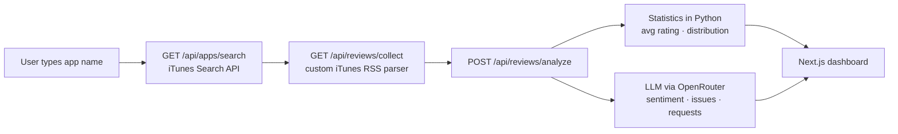

# App Store Review Analyzer

> Search any iOS app, collect its latest App Store reviews and get a product dashboard: exact rating statistics computed in code, plus key issues and feature requests extracted by an LLM. Built as a test assignment for OBRIO.


---

## How it works



**Key design choice: numbers come from code, words come from the LLM.** The average rating and the 1–5★ distribution are calculated deterministically in Python. The model only does what it is good at — reading free text and summarizing sentiment, technical problems and feature requests. LLMs are unreliable at counting, so they never touch the metrics.

The RSS parser pages through the `customerreviews` feed (most recent first), handles single-entry responses and empty pages, and stops when the feed runs out.

## Example output

From [`demo_report.md`](demo_report.md) — *Nebula: Horoscope & Astrology*, 100 reviews:

| Metric | Value |
|---|---|
| Average rating | 4.35 ★ |
| Distribution | 5★ 72 · 4★ 12 · 3★ 5 · 2★ 3 · 1★ 8 |

**Key issues:** trial cancellation charges without warning · loading-screen freeze on older iPhones · Restore Purchases errors
**Feature requests:** Moon-sign compatibility · iOS home-screen widget · multiple profiles for friends

## Quick start

```bash
cp backend/.env.example backend/.env   # add your OpenRouter key
docker-compose up --build
```

| Service | URL |
|---|---|
| Dashboard | http://localhost:3000 |
| API docs (Swagger) | http://localhost:8000/docs |

`backend/.env`:

```bash
OPENROUTER_API_KEY=your_key
OPENROUTER_MODEL=nvidia/nemotron-3-ultra-550b-a55b:free
```

## API

| Method | Endpoint | Description |
|---|---|---|
| `GET` | `/api/apps/search?query=` | Up to 10 matching apps (name, developer, id, icon) |
| `GET` | `/api/reviews/collect?app_id=&count=100` | Latest US reviews: rating, author, title, text |
| `POST` | `/api/reviews/analyze` | Statistics + LLM insights for a list of reviews |

## Limitations & next steps

- The public RSS feed exposes only the most recent reviews of one country (US) — no historical data
- The LLM response is parsed as raw JSON; switching to structured outputs (`instructor` / Pydantic) would remove format failures on free models
- Long review lists can exceed small context windows — batching (map-reduce summarization) would scale it to thousands of reviews
